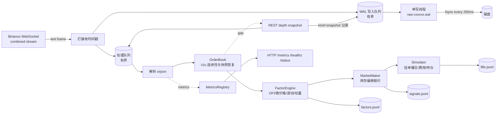

# TickForge 系统架构

## 1. 目标与边界

TickForge 是一个**可运行、可验证、可复现**的实时行情处理 demo：

- 接入 Binance 现货公开行情（默认 6 个 `*USDT` 交易对，`depth@100ms` + `aggTrade` + `bookTicker`）；
- 所有原始 WebSocket 帧先进入预写日志（WAL），再进入处理流水线；
- 在内存中按 Binance 的 `U/u` 规则重建 L2 订单簿，识别丢包并自动用 REST 快照恢复；
- 计算 OFI、microprice、价差、深度不平衡、成交不平衡、已实现波动和动量等因子；
- 用确定性的做市策略产生双边报价信号，并由模拟执行器撮合、记账；
- 提供 `/healthz`、`/readyz`、`/status`、`/metrics`；
- 支持从 WAL **逐字节确定性回放**，并对比因子/信号/成交摘要。

非目标：真实下单、收益优化、交易所私有 API、托管/多机高可用、内核旁路或 FPGA 级延迟。本项目的核心是**数据不丢、状态可恢复、结果可复现**，以及在 72 小时内把工程闭环做完整。

## 2. 数据源选择

Binance 官方主站 `stream.binance.com` 在部分网络环境下不可达。行情专用域名 `data-stream.binance.vision` 和 `data-api.binance.vision` 只提供公开市场数据，不需要 API Key，是题目允许的免费高频数据源，且在本机网络可直接访问。配置集中在 `config/default.toml`，可用环境变量或 CLI 覆盖。

订阅 6 个交易对 × 3 条流：

```text
<symbol>@depth@100ms   diff depth（订单簿增量，带 U/u）
<symbol>@aggTrade      聚合成交
<symbol>@bookTicker    最优买卖档（独立参照/新鲜度）
```

多交易对用于在 15 分钟窗口内制造有统计意义的消息负载；BTCUSDT 始终包含在主列表中。

## 3. 总体数据流



关键顺序保证：

1. **WAL 先行**：`_ingest()` 在单把 ingestion 锁内分配全局 `seq`、把原始帧交给 WAL 队列、再放入处理队列。`seq` 在 append 前赋值，因此 `seq` 顺序 = WAL 物理顺序 = 处理顺序。
2. **不静默丢弃**：WAL 队列或处理队列满时，ingestion 等待并计数（反压），而不是丢包。原始帧一旦读入，最终必须落盘。
3. **快照也是事件**：REST 快照以 `kind=2` 写入 WAL 的同一顺序位置。回放时不需要网络，也能在完全相同的位置重建订单簿。

## 4. 预写日志（WAL）

每条记录 40 字节头 + 原始 payload：

```text
magic "TFW1" | kind u8 | 3B pad | len u32 | crc32 u32 |
recv_wall_ns i64 | recv_mono_ns i64 | seq u64 | payload
```

- `kind=1`：WebSocket 原始文本帧（不做任何改写）；
- `kind=2`：REST depth 快照 JSON（含原始价格/数量字符串、`lastUpdateId`、请求时间）；
- 分段 `raw-000001.wal`，默认 64 MiB 轮转，段关闭时计算 SHA-256；
- `fsync_policy`：
  - `interval`（默认）：每 250 ms 组提交 fsync，延迟与持久性折中；
  - `always`：每条记录 fsync 后才进入处理队列，用于强持久性/高延迟对比实验；
  - `never`：只在轮转/关闭时同步，用于纯吞吐基线；
- 关闭时排空队列、flush+fsync、生成 `wal-manifest.json`（段名、记录数、字节数、SHA-256）；
- 读取端校验 magic、长度上限、CRC32、seq 严格递增；只有最后一段的尾部截断可在显式允许时容忍。

为什么不用数据库？demo 需要证明的是**字节级无损、低开销、可校验**。顺序追加 + CRC + 分段清单比引入外部依赖更容易验证，也更贴近行情落盘的常见做法。若需要查询能力，可在 WAL 之后异步构建 Parquet/ClickHouse，而不影响热路径。

## 5. 订单簿与状态恢复

每个 symbol 一个 `OrderBook`：

- 价格→数量用 `dict[int, int]`，价格/数量均为 1e-8 tick 的整数，避免浮点键相等问题；
- 最优档用**懒删除堆**维护，`top_levels(n)` 只弹出 n 个有效档再放回，避免每个事件全量排序；
- 快照与增量严格遵循 Binance spot 规则：
  - 第一条可应用增量满足 `U <= lastUpdateId + 1 <= u`；
  - 后续事件要求 `U <= lastUpdateId + 1` 且 `u > lastUpdateId`（允许重叠、拒绝重复）；
  - `U > lastUpdateId + 1` 判定为丢包，进入 `awaiting_snapshot`，当前事件进入有界缓冲；
- 快照到达后重建簿、按序重放缓冲；若快照过旧（缓冲首事件仍 `U > last+1`），保留缓冲并请求更新快照；
- 应用后若 `best_bid >= best_ask`，判定为交叉异常，立刻隐藏订单簿并请求快照，绝不让交叉状态进入因子；
- 断线重连不做“无记录的状态重置”：由下一笔 depth 的 `U/u` 连续性自然判定是否需要快照。这样 live 与 replay 的状态转移完全一致，不会出现“live 清了缓冲、replay 没清”的隐性差异。若重连期间无丢失，订单簿可以无缝续用。

缓冲上限默认 50,000 条。快照请求由运行时异步执行，失败指数退避重试；期间策略挂单一律撤销。

## 6. 并发与内存模型

- **一个 asyncio 事件循环**：WebSocket 读取、快照请求、HTTP 服务、流水线处理都在同一个线程；流水线函数是同步的，天然无锁且确定性好。
- **一个 WAL 写线程**：避免 `os.write/fsync` 阻塞事件循环；通过有界 `queue.SimpleQueue` 与事件循环通信。
- **两个有界队列**：WAL 队列（默认 500k）与处理队列（默认 200k）。队列深度、反压次数、处理滞后均进入指标与健康检查。
- 每个 symbol 的簿约 1 万档；6 个 symbol 的 dict + heap + 因子窗口在几十 MB 量级。因子窗口用 `deque`，按事件时间淘汰，内存有界。
- `orjson` 解析；原始 bytes 只读传递，WAL 写线程直接写入，不做二次序列化。

Python 的取舍：GIL 与解释器开销决定了它不适合真正的微秒级 HFT。但在 300–1000 msg/s 的公开行情 demo 上，单线程流水线足以留出数量级余量，换来 72 小时内可交付、可审计、可回放的完整工程。若迁移到生产，可保持接口不变，把解析/簿/因子替换为 C++/Rust 扩展或多进程共享内存。

## 7. 因子、策略与执行

因子（每 symbol，100 ms 节流快照）：

- `mid`、`microprice`（用对侧数量加权）；
- `spread_bps`；
- `ofi_1s`：相邻最优档变化的经典 order-flow imbalance，1 秒滑动；
- `depth_imbalance_5`：前 5 档买卖量不平衡；
- `trade_imbalance_1s`：主动买/卖成交量不平衡；
- `realized_vol_bps`：mid 对数收益平方的 EWMA 平方根；
- `momentum_5s`：5 秒动量（历史不足 4 秒返回 0）。

策略是**演示用做市商**：以 microprice 为锚，叠加 OFI/动量微调得到公允价，按库存做偏移，按波动设置半价差，输出双边/单边报价。`Simulator` 用后续 `aggTrade` 穿越报价来模拟 maker 成交（部分成交、费用、平均成本、持仓/名义上限）。因子与策略仅用于打通链路，不评价收益。

## 8. 确定性与回放

回放把 WAL 中每条记录按原顺序、原 `recv_*` 时间戳送入**同一个 `Pipeline`**：

- 因子/策略/模拟器不使用墙钟、不用随机数；快照节流用交易所事件时间；
- 派生 JSONL 不写接收时间戳，只用事件字段、`seq` 和确定性浮点计算；
- live 与 replay 都把快照当普通输入事件处理，因此快照插入位置一致；
- 关闭时对三个派生文件计算 SHA-256 并写入 `summary.json`；replay 重新计算并逐项对比，同时对比计数与 WAL 记录数；
- `python -m tickforge replay --run <run> --verify` 在摘要/计数不一致时返回非零退出码。

这条链路是“系统正确性”最有力的证据：它不仅检查程序没崩，还检查**同一输入产生同一输出**，并且原始数据可以独立校验 CRC 与分段哈希。

## 9. 健康与故障处理

`/healthz` 只有在以下条件全部满足时返回 200：

- WebSocket 已连接且最近一条消息年龄 < `stale_timeout_ms`；
- 启动后 5 秒起，所有 symbol 的订单簿已同步；
- WAL 无错误；
- 处理滞后 < 2 s，处理队列未接近满；
- 内部错误计数低于阈值。

故障路径：

| 故障 | 行为 | 证据 |
|---|---|---|
| WS 断开 | 指数退避重连；记录 data gap；订单簿由 `U/u` 连续性判定是否重建 | `ws_disconnect_total`、`data_gaps` |
| 消息间隔 >5s | 主动判定 stale 并重连 | `ws_stale_reconnect_total` |
| depth 丢包 | 缓冲 + REST 快照 + 重放缓冲 | `book_gaps_total`、`book_resyncs_total` |
| 快照接口失败 | 指数退避重试，健康转 503，策略撤单 | `snapshot_requests_total{status=error}`、日志 |
| 磁盘写失败 | WAL 标记错误、停止接收、优雅退出并保留已落盘数据 | `wal.error`、`clean_shutdown=false` |
| 处理变慢 | 有界队列反压到 socket，记录滞后 | `pipeline_backpressure_total`、`processing_lag_ms` |
| 进程被杀 | 已 fsync 的 WAL 可回放；尾部未 fsync 记录可能丢失（`interval` 模式） | 回放 + CRC 校验 |

## 10. 主要权衡

| 选择 | 收益 | 代价 | 结论 |
|---|---|---|---|
| 原始帧先落 WAL 再解析 | 可回放、可审计、崩溃恢复 | 写盘/内存拷贝开销 | 接受；这是题目“同步稳定落盘”的核心 |
| `fsync=interval` 默认 | p99 延迟低、吞吐高 | 未同步尾部可能丢失；250ms 是目标间隔，不是硬上界 | 默认；`always` 作为强持久性选项 |
| 单事件循环 + 单写线程 | 无锁、确定性、易验证 | 无法利用多核扩展 | demo 负载下余量充足；扩展路径明确 |
| 全深度 diff + REST 快照 | 真实、能演示丢包恢复 | 重启/断线恢复有 RTT | 比 partial depth 更能体现系统能力 |
| 回放使用同一 Pipeline | 真正验证确定性 | 需要把快照写入 WAL | 值得，是本项目的亮点 |
| Python | 交付速度、可读性、生态 | 延迟不如 C++/Rust | 明确记录为局限，不伪装成生产级 HFT |

## 11. 目录结构

```text
tickforge/
  feed/        WebSocket 连接器、REST 快照客户端
  store/       WAL 写入/读取、派生 JSONL
  book/        L2 订单簿、序列恢复
  factor/      因子窗口
  strategy/    演示做市策略
  exec/        模拟撮合与持仓
  runtime/     实时引擎、共享流水线
  replay/      回放与校验
  metrics/     Prometheus 指标
  server/      健康检查与状态 HTTP
tools/         运行分析、样本裁剪
scripts/       15 分钟运行、回放校验
docs/          架构、接口、性能、验证、AI 协作
```

## 12. 已知局限

- 公开 WebSocket 无重放 API，断线期间的真实成交无法补齐（订单簿靠快照恢复；raw 数据缺口会被记录）；
- 单机单进程、Python GIL，不能代表真实 colo/HFT 延迟；
- 模拟撮合不考虑队列位置、撤单延迟、交易所撮合规则与市场冲击；`Simulator` 允许负仓位/负现金，是抽象记账器，不是 Binance 现货账户，也不建模借币/保证金/强平；
- 只做公开行情，不涉及私有 API、订单网关、风控前置；
- 未做多机复制/仲裁；WAL 是单机顺序文件。
