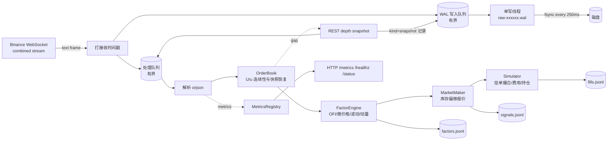

# TickForge 系统架构

## 1. 目标与边界

我做 TickForge 的目标很明确：交一个能跑、能验证、也能复现的实时行情处理 demo。设计上我最在意三点：原始帧先进入 WAL 队列，再进入处理队列；独立写线程负责异步写入分段 WAL。默认 `interval` 按目标间隔组提交，处理不等待写入或 fsync 完成；`always` 则等待 fsync 完成后才进入处理队列。REST 快照作为事件写进 WAL 的同一顺序位置，live 和 replay 共用同一条流水线，回放时逐字节对比因子、信号和成交摘要。它接入 Binance 现货公开行情，默认订阅 6 个 `*USDT` 交易对，每个交易对 `depth@100ms`、`aggTrade`、`bookTicker` 三条流；订单簿按 `U/u` 规则重建，丢包用 REST 快照恢复，再算因子、跑确定性的做市策略和模拟执行，对外提供 `/healthz`、`/readyz`、`/status`、`/metrics`。

有几件事我一开始就没打算做：真实下单、收益优化、交易所私有 API、托管或多机高可用、内核旁路、FPGA 级延迟。这个项目的核心只有三件事，数据不丢、状态可恢复、结果可复现，再加一个时间约束：72 小时内把工程做完整。

## 2. 数据源选择

Binance 官方主站 `stream.binance.com` 在部分网络环境下不可达，这是我选数据源时先要解决的问题。行情专用域名 `data-stream.binance.vision` 和 `data-api.binance.vision` 只提供公开市场数据，不需要 API Key，题目允许，属于免费高频数据源，本机网络也能直接访问，所以最终用了它们。配置集中在 `config/default.toml`，环境变量或 CLI 都能覆盖。

订阅 6 个交易对 × 3 条流：

```text
<symbol>@depth@100ms   diff depth（订单簿增量，带 U/u）
<symbol>@aggTrade      聚合成交
<symbol>@bookTicker    最优买卖档（独立参照/新鲜度）
```

多交易对是为了在 15 分钟窗口内制造有统计意义的消息负载；BTCUSDT 始终包含在主列表里。

## 3. 总体数据流



这条链路里，顺序是我最在意的东西，关键保证有三条。

1. WAL 必须先行。`_ingest()` 在单把 ingestion 锁内分配全局 `seq`，把原始帧交给 WAL 队列，再放入处理队列。`seq` 在 append 前赋值，所以 `seq` 顺序、WAL 物理顺序、处理顺序是同一个顺序。
2. 不静默丢弃。WAL 队列或处理队列满时，ingestion 会等待并计数，也就是反压，而不是丢包；原始帧一旦读入，最终必须落盘。
3. 快照也是事件。REST 快照以 `kind=2` 写入 WAL 的同一顺序位置，回放时不需要网络，也能在完全相同的位置重建订单簿。

## 4. 预写日志（WAL）

每条记录 40 字节头 + 原始 payload；具体字段和二进制布局见 `docs/接口设计.md` §2。

`kind=1` 是 WebSocket 原始文本帧，我不做任何改写；`kind=2` 是 REST depth 快照 JSON，里面保留原始价格/数量字符串、`lastUpdateId` 和请求时间。WS 帧是原始字节；快照是重编码后的规范化 JSON，原始 HTTP body 不单独保存——如果“全部原始行情”按字节级理解，WS 帧满足，快照只能算规范化表示。分段文件按 `raw-000001.wal` 命名，默认 64 MiB 轮转，段关闭时计算 SHA-256。

`fsync_policy` 我设了三个值。`interval` 是默认值，每 250 ms 组提交一次 fsync，在延迟和持久性之间取折中；`always` 每条记录 fsync 后才进入处理队列，用于强持久性/高延迟对比实验；`never` 只在轮转或关闭时同步，用于纯吞吐基线。

`interval`/`always` 在新段创建或轮转后会对 WAL 目录做 fsync（POSIX；Windows 没有等价操作），避免目录项在掉电时丢失；`never` 不做。读取端使用运行 config 的 `record_max_bytes`，不再固定 8 MiB，避免写入端可配置更大记录、读取端却读不回来的问题。

关闭时先排空队列，再 flush+fsync，再生成 `manifest.json`，内容包括段名、记录数、字节数和 SHA-256。读取端会校验 magic、长度上限、CRC32 和 seq 严格递增；只有末尾一段的尾部截断，可以在显式允许时容忍。

为什么不用数据库？这个 demo 要证明的是字节级无损、低开销、可校验。顺序追加加 CRC 加分段清单，比引入外部依赖更容易验证，也更贴近行情落盘的常见做法。如果以后需要查询能力，可以在 WAL 之后异步构建 Parquet 或 ClickHouse，不影响热路径。

## 5. 订单簿与状态恢复

每个 symbol 一个 `OrderBook`，实现上有几个选择。

价格→数量用 `dict[int, int]`，价格和数量都是 1e-8 tick 的整数，避免浮点键相等的问题。最优档用懒删除堆维护，`top_levels(n)` 只弹出 n 个有效档再放回，不会每个事件都全量排序。

快照与增量严格遵循 Binance spot 规则：第一条可应用增量要满足 `U <= lastUpdateId + 1 <= u`；后续事件要求 `U <= lastUpdateId + 1` 且 `u > lastUpdateId`，允许重叠、拒绝重复；`U > lastUpdateId + 1` 就判定为丢包，进入 `awaiting_snapshot`，当前事件进入有界缓冲。

快照到达后重建簿，按序重放缓冲。如果快照过旧，也就是缓冲首事件仍满足 `U > last+1`，就保留缓冲并请求更新的快照。应用之后如果 `best_bid >= best_ask`，判定为交叉异常，立刻隐藏订单簿并请求快照，绝不让交叉状态进入因子。

断线重连我不做“无记录的状态重置”。由下一笔 depth 的 `U/u` 连续性自然判定是否需要快照，这样 live 和 replay 的状态转移完全一致，不会出现 live 清了缓冲、replay 没清这种隐性差异。如果重连期间没有丢失，订单簿可以直接续用。

缓冲上限默认 50,000 条。快照请求由运行时异步执行，失败就指数退避重试；这期间策略挂单一律撤销。健康循环每秒检查未同步的订单簿，没有在途任务时会强制重试快照（`force`），避免低流动性 symbol 在没有新 depth 事件时一直卡住。

## 6. 并发与内存模型

并发模型很简单，我想的是把不确定性压到最低。整个进程只有一个 asyncio 事件循环，WebSocket 读取、快照请求、HTTP 服务和流水线处理都在同一个线程；流水线函数是同步的，所以天然无锁，确定性也好。另有一个 WAL 写线程，避免 `os.write/fsync` 阻塞事件循环，它和有界 `queue.Queue` 通信。队列有两个，WAL 队列默认 500k，处理队列默认 200k；队列深度、反压次数和处理滞后都进了指标与健康检查。

内存占用上，每个 symbol 的簿大约 1 万档，6 个 symbol 的 dict、堆和因子窗口加起来在几十 MB 量级。因子窗口用 `deque`，按事件时间淘汰，内存有界。解析用 `orjson`，原始 bytes 只读传递，WAL 写线程直接写入，不做二次序列化。

Python 的取舍我也说清楚。GIL 和解释器开销决定了它不适合真正的微秒级 HFT。主结果窗口平均约 337.5 帧/s、depth 约 47.3 次/s（窗口内 1 秒峰值 2,665 帧/s），这个负载下单线程流水线没有成为瓶颈；但高速回放关闭了部分实时工作，不能把它当成十倍实时负载的容量证明。换来的是 72 小时内把系统做完，而且出了问题能查、结果能回放。如果迁到生产，接口可以不变，把解析、簿、因子替换成 C++/Rust 扩展或多进程共享内存。

## 7. 因子、策略与执行

因子按 symbol 计算，每 100 ms 节流输出一次快照。`mid` 和 `microprice` 是价格基准，后者用对侧数量加权；`spread_bps` 是价差；`ofi_1s` 用相邻最优档变化算经典 order-flow imbalance，窗口 1 秒；`depth_imbalance_5` 看前 5 档买卖量不平衡；`trade_imbalance_1s` 是主动买/卖成交量不平衡；`realized_vol_bps` 是 mid 对数收益平方的 EWMA 再开方；`momentum_5s` 是 5 秒动量，历史不足 4 秒时返回 0。

策略只是个演示用做市商。它以 microprice 为锚，叠加 OFI 和动量微调得到公允价，按库存做偏移，按波动设置半价差，输出双边或单边报价。默认配置启用 `round_to_tick`：bid 向下、ask 向上取到该 symbol 的交易所 tick；历史 15 分钟 run 的 config 在重算时已补 `round_to_tick=true`，执行结果用同一份 WAL 重算；最终单源 run 的 config 直接包含该字段。缺字段的旧 config 默认 false，仅用于兼容。`Simulator` 用后续 `aggTrade` 穿越报价来模拟 maker 成交，处理部分成交、费用、平均成本、持仓和名义上限。因子和策略在这里只负责把链路打通，不评价收益。

## 8. 确定性与回放

回放把 WAL 中每条记录按原顺序、原 `recv_*` 时间戳送入同一个 `Pipeline`。为了做到这一点，因子、策略、模拟器都不使用墙钟、不用随机数，快照节流用交易所事件时间；派生 JSONL 不写接收时间戳，只用事件字段、`seq` 和确定性浮点计算。live 和 replay 都把快照当普通输入事件处理，所以快照插入位置一致。关闭时对三个派生文件计算 SHA-256 并写入 `summary.json`；replay 重新计算并逐项对比，同时对比计数与 WAL 记录数。`python -m tickforge replay --run <run> --out <run>-replay --verify` 在摘要或计数不一致时返回非零退出码。

这条链路是我手里关于系统正确性最有力的证据。它检查的不只是程序没崩，还有同一输入产生同一输出，原始数据也能独立校验 CRC 与分段哈希。

## 9. 健康与故障处理

`/healthz` 只有在下面几条全部满足时才返回 200：

- WebSocket 已连接，且最近一条消息年龄 < `stale_timeout_ms`；
- 启动后 5 秒起，所有 symbol 的订单簿已同步；
- WAL 无错误；
- 处理滞后 < 2 s（取“最近到达帧 − 最后已处理帧”和“最老待处理事件已等待时间”的较大者，避免行情安静时漏报处理停滞），处理队列未接近满；
- 内部错误计数低于阈值。

故障路径我都列在表里：

| 故障 | 行为 | 证据 |
|---|---|---|
| WS 断开 | 指数退避重连；记录 data gap；订单簿由 `U/u` 连续性判定是否重建 | `ws_disconnect_total`、`data_gaps` |
| 消息间隔 >5s | 主动判定 stale 并重连 | `ws_stale_reconnect_total` |
| depth 丢包 | 缓冲 + REST 快照 + 重放缓冲 | `book_gaps_total`、`book_resyncs_total` |
| 快照接口失败 | 指数退避重试，健康转 503，策略撤单 | `snapshot_requests_total{status=error}`、日志 |
| 磁盘写失败 | WAL 标记错误、停止接收、优雅退出并保留已落盘数据 | `wal.error`、`clean_shutdown=false` |
| 派生文件关闭/刷盘失败 | 记录失败项，干净关停标记为 false；已落盘的原始数据不回滚 | `derived_errors`、`derived_complete=false`、`clean_shutdown=false` |
| 处理变慢 | 有界队列反压到 socket，记录滞后；健康取到达差值与最老待处理等待的较大者 | `pipeline_backpressure_total`、`processing_lag_ms`、`oldest_pending_ms` |
| 进程被杀 | 已 fsync 的 WAL 可回放；尾部未 fsync 记录可能丢失（`interval` 模式） | 回放 + CRC 校验 |

## 10. 主要权衡

这些取舍都写在这张表里，没有藏：

| 选择 | 收益 | 代价 | 结论 |
|---|---|---|---|
| 原始帧先入 WAL 队列再解析 | 可回放、可审计、崩溃恢复 | 写盘/内存拷贝开销 | 接受；默认 `interval` 组提交，正常关闭时排空并 fsync，逐条持久化用 `always` |
| `fsync=interval` 默认 | p99 延迟低、吞吐高 | 未同步尾部可能丢失；250ms 是目标间隔，不是硬上界 | 默认；`always` 作为强持久性选项 |
| 单事件循环 + 单写线程 | 无锁、确定性、易验证 | 无法利用多核扩展 | 主结果负载下未成为瓶颈；扩展路径明确 |
| 全深度 diff + REST 快照 | 真实、能演示丢包恢复 | 重启/断线恢复有 RTT | 比 partial depth 更能体现系统能力 |
| 回放使用同一 Pipeline | 真正验证确定性 | 需要把快照写入 WAL | 值得，是本项目的亮点 |
| Python | 交付速度、可读性、生态 | 延迟不如 C++/Rust | 明确记录为局限，不伪装成生产级 HFT |

## 11. 目录结构

见 `README.md` 的“目录与测试”；模块职责见 `tickforge/README.md`。

## 12. 已知局限

到交付时仍然存在的局限：

- 公开 WebSocket 不自动补发，本 demo 尚未实现 REST 补采；历史 depth 增量和原 WS 帧不可恢复，gaps 记在 `data_gaps`。
- 单机单进程、Python GIL，不能代表 colo/HFT 延迟；WAL 是单机顺序文件，未做多机复制。
- 模拟撮合不建模队列位置、撤单延迟和市场冲击；`Simulator` 允许负仓位/负现金，是抽象记账器，不是 Binance 现货账户。
